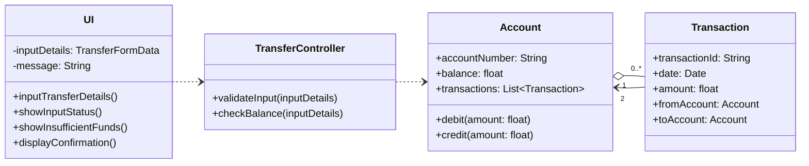

# Grading Rubric: Cohort Exercise - Domain & Solution Modeling

**Total Marks:** 20

<strong>Task 1: The Domain Phase (10 Marks)</strong>

**1. Classes and Attributes (2 Marks)**

*   **[2.0 Marks]** Identifies at least six valid domain classes with relevant attributes mapped accurately to the business narrative.

*   **[1.0 Mark]** Identifies fewer than six classes, or the classes/attributes do not accurately reflect the provided scenario.

*   **[0.0 Marks]** Missing or fundamentally incorrect classes.

**2. Relationships and Justifications (3 Marks)**

*   **[3.0 Marks]** Correctly identifies at least one of each relationship type: Inheritance, Association, Aggregation, and Composition. Provides logical business justifications for *all* choices based on the narrative.

*   **[2.0 Marks]** Identifies all relationship types but justifications are weak or missing for one/two of them. *OR* Misses one relationship type but provides excellent justifications for the rest.

*   **[1.0 Mark]** Missing multiple relationships, or incorrect usage of the concepts.

*   **[0.0 Marks]** Incomplete or incorrect attempt.

**3. Multiplicities and Justifications (2 Marks)**

*   **[2.0 Marks]** Multiplicities (e.g., 1..*, 0..1) are correctly applied to the identified relationships with clear, logical business justifications supporting them.

*   **[1.0 Mark]** Multiplicities are missing on some relationships, or the justifications provided do not logically fit the business rules.

*   **[0.0 Marks]** No multiplicities provided or completely incorrect formatting.

**4. UML Domain Class Diagram (3 Marks)**

*   **[3.0 Marks]** Diagram perfectly summarizes the above findings using standard UML notation (proper line types, diamonds for aggregation/composition, italicized/hollow arrows for inheritance). **Zero software methods or navigability arrows are present.**

*   **[2.0 Marks]** Minor syntax errors in UML notation, OR accidentally includes 1-2 software artifacts (methods, navigability arrows) violating the domain model rules.

*   **[1.0 Mark]** Major UML syntax errors, OR heavily pollutes the diagram with solution-space concepts (methods, explicit IDs used as foreign keys, transient dependencies).

*   **[0.0 Marks]** No diagram provided.

<strong>Task 2: The Solution Phase (5 Marks)</strong>

*Note: This section focuses exclusively on the Delivery, Review, and Payment portions of the narrative.*

**1. Classes and Scope (1 Mark)**

*   **[1.0 Mark]** Includes at least four relevant software classes.

*   **[0.0 Marks]** Fails to include at least four classes, or includes classes entirely outside the requested scope.

**2. Operations and Visibility (2 Marks)**

*   **[2.0 Marks]** Relevant operations (methods) are mapped to appropriate classes. Visibility symbols (`-` for private attributes, `+` for public methods) are used consistently and correctly across all entities.

*   **[1.0 Mark]** Missing visibility symbols on attributes/methods, OR assigns methods to classes that violate basic cohesion.

*   **[0.0 Marks]** Methods and visibility markers are entirely missing.

**3. Navigability Arrows / Associations (1 Mark)**

*   **[1.0 Mark]** Uses solid lines with arrows (`->`) to show valid permanent in-memory references between classes. Includes appropriate variable/role names at the tips of these arrows.

*   **[0.0 Marks]** Incorrect arrow types used for associations, or missing role/variable names at the tips.

**4. Dependency Arrow (1 Mark)**

*   **[1.0 Mark]** Includes at least one properly formatted dependency arrow (dashed line `-.->`) demonstrating a transient relationship (e.g., passing a parameter to a method). 

*   **[0.0 Marks]** Missing the dependency arrow, or uses a dashed line incorrectly (e.g., trying to use it for an interface implementation or standard association).

<strong>Task 3: Software Execution (5 Marks)</strong>

*   **[2.0 Marks - Step 1]** Correctly extracts the first call: (Acceptable without the parameter).
*   **[1.5 Marks - Step 2]** Correctly extracts the second call: (Acceptable without the parameter) .
*   **[1.5 Marks - Step 3]** Correctly extracts the third call:(Acceptable without the parameter)  .

**Deductions for Formatting:**
Returning dotted arrows are return values, not method calls. Deduct 0.5 marks for each return value incorrectly listed as a method call.

